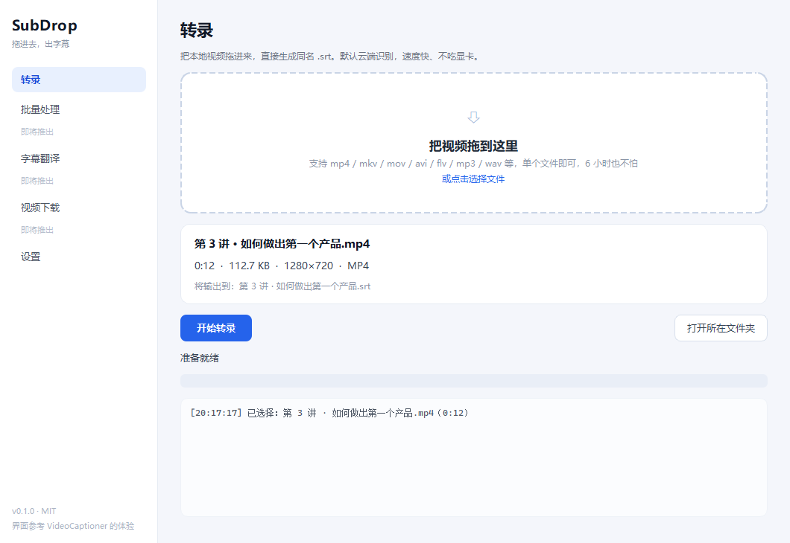
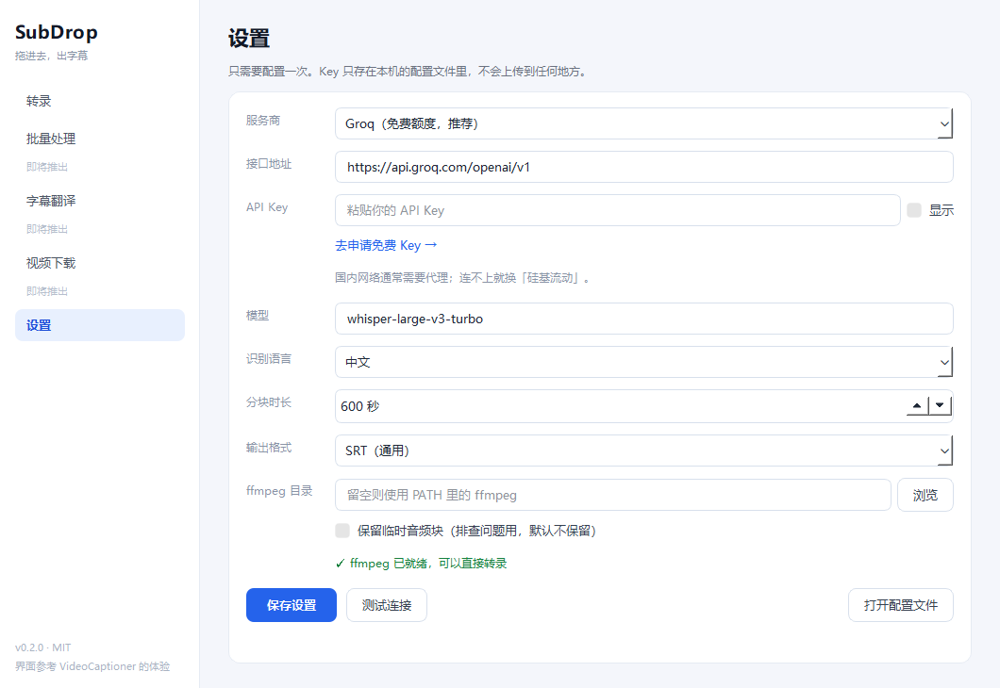

# SubDrop · 拖进去，出字幕

[](https://github.com/compassscout/subdrop/actions/workflows/ci.yml)
[](https://github.com/compassscout/subdrop/releases)
[](LICENSE)



把本地视频拖进窗口，几分钟后旁边多出一个 `.srt`。

## 下载（Windows 免安装）

1. 打开 [Releases](https://github.com/compassscout/subdrop/releases/latest)，下载 `SubDrop-windows-x64.zip`（约 38 MB）
2. 解压到任意目录，双击 `SubDrop.exe`
3. 系统里需要有 ffmpeg（`ffmpeg -version` 能跑就行），否则设置页会提示

不需要装 Python。首次运行去「设置」填一个 API Key，之后就不用再管了。


专为**长视频**做的：6 小时课程、10 小时直播回放，切成 10 分钟一块送去识别，
边转边删，断点续跑，中途崩了重开能接着来。

> 目前只做「本地视频 → 字幕」这一件事。视频下载、翻译、字幕烧录、批量队列
> 都在路线图里，界面上留了位置，但还没实现 —— 宁可少做，不做半成品。

## 它和别的字幕工具有什么不一样

- **只做转录**，不需要配 LLM、不需要理解「断句优化」「反思翻译」这些概念
- **云 + 本地混合**：先用云 ASR（快、不挑机器），本地 Whisper 后端在路线图中
- **MIT 协议**，代码干净，随便改随便商用
- **单文件即可运行**，没有安装器、没有后台服务、不改注册表

## 快速开始

需要 Python 3.10+ 和 ffmpeg（`ffmpeg -version` 能跑就行）。

```bash
git clone https://github.com/compassscout/subdrop.git
cd subdrop

# 用 uv（推荐）
uv sync
uv run subdrop

# 或者用 pip
python -m venv .venv && .venv\Scripts\activate
pip install -e .
python -m subdrop
```

第一次启动后，去「设置」里选一个服务商、粘贴 API Key，然后拖视频进来就行。



只想先看看界面、不想配 Key？用演示后端跑一遍：

```bash
uv run subdrop-cli 你的视频.mp4 --mock
```

### 命令行

```bash
subdrop-cli video.mp4                       # 输出 video.srt
subdrop-cli video.mp4 -o out.srt            # 指定输出
subdrop-cli video.mp4 --mock                # 不联网，跑通流程用
```

## 选哪个 ASR 服务

| 服务商 | 免费额度 | 时间戳 | 国内直连 | 备注 |
|---|---|---|---|---|
| Groq | 有，较宽松 | 有 | 需代理 | 默认选项，`whisper-large-v3-turbo` 又快又准 |
| OpenAI | 无 | 有 | 需代理 | `whisper-1`，稳定 |
| 硅基流动 | 有 | **无** | 可以 | `SenseVoiceSmall`，中文强，但只回文本，时间轴靠字数均分，精度一般 |
| 自建 | - | 看实现 | 看部署 | 任何 OpenAI 兼容的 `/audio/transcriptions` 都能接 |

只返回纯文本的服务也能用：会按标点切句、按字数比例分配时间轴。
精度不如原生时间戳，但比没有字幕强。

## 为什么不是本地跑 Whisper

因为你的电脑可能没有显卡。本地 `faster-whisper` 在 4 核低压 CPU 上大约 3 倍实时，
6 小时视频要跑 2 小时；云接口只要 2 分钟。所以默认云优先，本地后端作为离线兜底
放在路线图里 —— 需要模型下载和 1.5GB 磁盘，属于另一个量级的工程。

## 实现要点

```
ffprobe 读时长
  └─ ffmpeg 抽 16kHz 单声道 mp3，按 600s 切块     ← 内存恒定，6 小时不爆
       └─ 逐块 POST /audio/transcriptions          ← 每块完成即落盘缓存
            └─ 按块偏移平移时间戳，修复接缝断句    ← 避免字幕出现半句话
                 └─ 排序 / 去空 / 消重叠 → .srt
```

缓存按「文件路径 + 大小 + 修改时间 + 分块时长」散列，换文件不会串味。

## 路线图

- [x] 本地视频 → SRT，长视频分块与断点续跑
- [x] OpenAI 兼容云 ASR（Groq / OpenAI / 硅基流动 / 自建）
- [ ] 本地 faster-whisper 后端（离线、免 Key）
- [ ] 批量队列（拖一堆视频进去）
- [ ] 字幕翻译（LLM，可选）
- [ ] 字幕烧录（ASS 样式 + ffmpeg）
- [ ] 视频链接下载（yt-dlp）
- [ ] 打包成 Windows 免安装 exe

## 开发

```bash
uv sync --extra dev
uv run pytest -q
```

## 许可证

MIT。见 [LICENSE](LICENSE)。

界面与交互参考了 [VideoCaptioner](https://github.com/WEIFENG2333/VideoCaptioner)
的使用体验，但代码、图标、文案均为独立实现，未使用其源码或素材。
